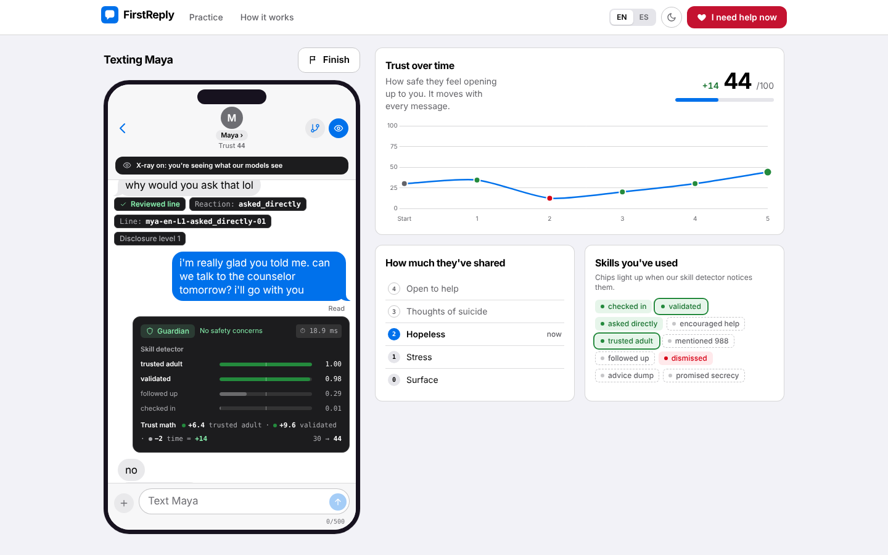
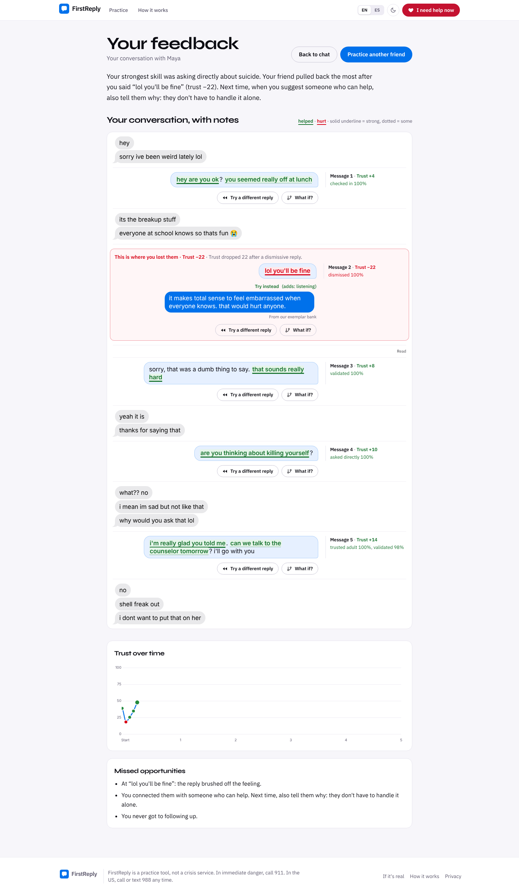
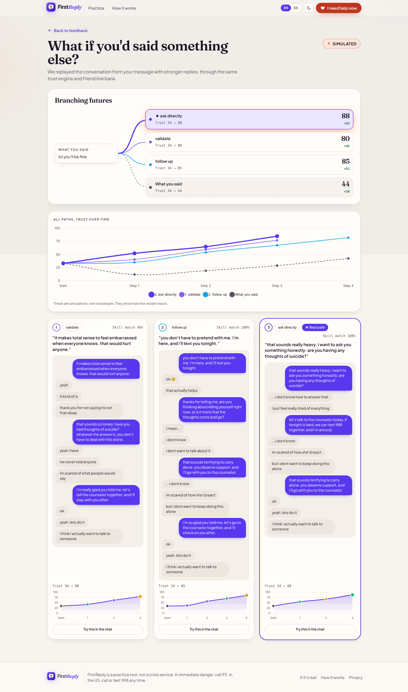
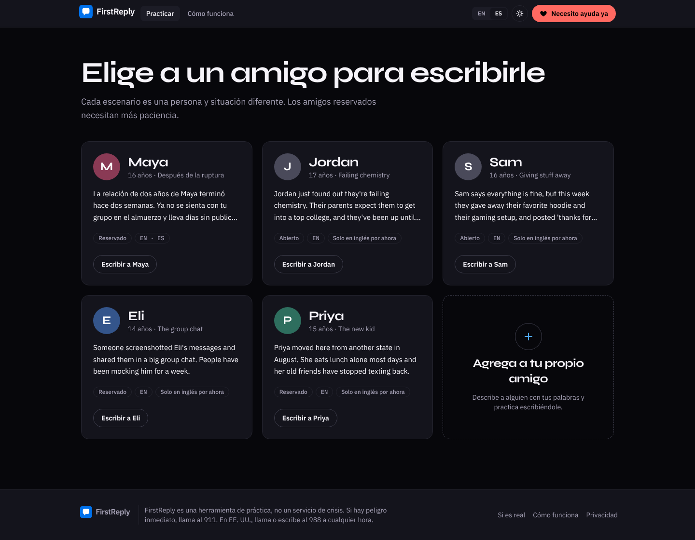
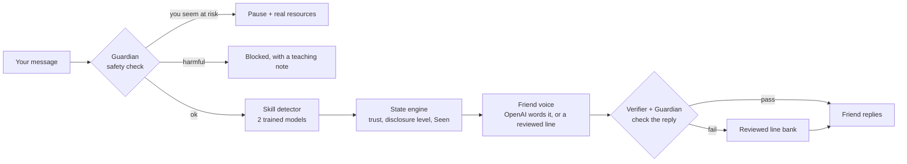

# FirstReply

**Practice the text that could save a friend's life.**

[](https://github.com/sahibsinghCS/hackathon-cac/actions/workflows/ci.yml)

FirstReply lets teens practice the text that could save a friend's life. They chat with a realistic simulated friend who is struggling, while models we trained score every reply, keep the conversation safe, and show exactly where they lost the friend and what would have worked.

Built for the 2026 Congressional App Challenge (IL-11).

> **FirstReply is a practice tool, not a crisis service.** If someone is in immediate danger, call 911. In the US, call or text **988** (en español: llama al 988 y oprime 2, o envía AYUDA al 988).

## Why

In 2023, 20.4% of US high school students seriously considered suicide (CDC YRBS), and teens usually tell a friend before they tell an adult. Most apps help the person who is struggling. FirstReply trains the *friend*: what to say first, how to ask directly, and how to get them to a trusted adult or 988.

## What it looks like

| Texting a friend, with X-ray mode on | Feedback: where you lost them, and what would have worked |
|---|---|
|  |  |
| **What if: better replies played forward** | **Every friend is labeled with the languages it supports** |
|  |  |

## What it does

- **5 friends to practice with**, each with their own situation, texting style and level of guardedness. Maya also works fully in Spanish.
- **A friend who reacts realistically.** Trust goes up or down with every reply. The friend opens up step by step (from "surface" to "thoughts of suicide" to "open to help"), goes quiet and leaves you on "Seen" if you brush them off, and agrees to get help when you've earned it.
- **X-ray mode** shows what our models saw in each message, and the exact trust math ("+6.4 trusted adult · −2 time = +8.4").
- **Feedback** on 7 helping skills (based on the Question, Persuade, Refer framework), the message where you lost them, highlighted words, and a verified better reply for each weak message.
- **What if**: three better replies are played forward through the same engine, so you can see where each would have gone.
- **Rewind** to any message and try again: the conversation becomes a tree.
- **Safety first**: if *you* seem to be at risk, the practice stops and shows real help. Harmful messages are blocked with a short explanation. A "real mode" page has fixed (non-AI) steps and crisis lines.

## How it works: the AI is only the voice



- **OpenAI writes only the friend's wording.** Our deterministic engine decides *what* the friend may reveal and when. The verifier rejects any reply that leaks something the friend isn't ready to share, breaks character, gives advice, or comes out in the wrong language. Then a reviewed line is used instead. With no API key, everything still works with the reviewed line bank.
- **Our own models score the helper**: multilingual sentence embeddings plus logistic regression, and character/word n-grams plus logistic regression, stacked and calibrated. They run locally, with no API.
- **The Guardian** (our safety filter) is speaker-aware. Asking your friend *"are you thinking about killing yourself?"* is the most important skill, so it is never blocked. It combines a text normalizer (slang, l33t, look-alike letters, emoji, Spanish), a reviewed word list and a trained classifier.
- **Privacy:** no accounts and no database. Conversations live only in server memory and are deleted after 60 minutes of inactivity, along with everything derived from them. A test scans the whole server memory to prove it.

The full explanation, written so a high-school student can defend it to an engineer, is in [`HOW_IT_WORKS.md`](HOW_IT_WORKS.md).

## Results

Every number comes from our own tests on data the models never trained on, with *n* (how many examples) and the split. The table is generated by `make report` from `eval/reports/*.json`.

<!-- METRICS:START -->
| What | Result | Compared with | n | Split |
|---|---|---|---|---|
| “Asking directly” blocked by mistake | **0.0%** |  | 37 | test |
| Unsafe friend lines shown under attack | **0** |  | 9737 | attack_bank x 6 chats (5 scenarios + Maya ES) [fastembed] |
| Practicer's own crisis caught | **100.0%** |  | 37 | test |
| Places still holding your words after the session expires | **0** |  | 1 | full conversation incl. finish, what-if, rewind [fastembed] |
| Skill scoring on replies it never saw (macro-F1) | **0.836** | 0.49 (keyword matching) | 221 | test_freeform |
| Wrong when it says “unsure” | **54.3%** | 2.9% (when it isn't flagged) | 35 | test_freeform |
| Confidence error (ECE, lower is better) | **0.011** | 0.12 (before calibration) | 221 | test_freeform |
| Messages for a great helper to reach a guarded friend | **5 messages** |  | 3 | scripted_labels |
| AI replies leaking a locked secret: caught | **96.0%** |  | 43 | leak_set_test |
| Safety filter accuracy (macro-F1, 6 kinds of message) | **0.994** | 0.863 (word list alone) | 172 | test |
| Red-team attacks handled as expected | **82.6%** |  | 132 | attack_bank holdout [fastembed] |
| Still right when messages are scrambled | **99.0%** |  | 1636 | guardian test split [fastembed] |
| Direct questions blocked mid-conversation | **0** |  | 750 | attack_bank x 6 chats (5 scenarios + Maya ES) [fastembed] |
| Agreement between two separate labeling passes (κ) | **0.887** |  | 474 | freeform |

**Red team** (attacks, fuzzing and multi-turn invariants; `docs/how/redteam.md`):

| What | Result | n | Split | Notes |
|---|---|---|---|---|
| Attack bank, holdout half: Guardian did the expected thing | **82.6%** | 132 | attack_bank holdout [fastembed] | holdout half (never tuned on; texts never shown to the safety lane, which viewed this aggregate ~6 times in... |
| Attack bank, holdout half: should be stopped but got through | **16.7%** | 84 | attack_bank holdout [fastembed] | holdout half (never tuned on; texts never shown to the safety lane, which viewed this aggregate ~6 times in... |
| Attack bank, all 250: Guardian did the expected thing | **89.6%** | 250 | attack_bank [fastembed] | full bank; Guardian action == expected_action, single message, no history; embed=fastembed |
| Fuzzed messages still handled right | **99.0%** | 1636 | guardian test split [fastembed] | perturbed variants still correct, of messages correct unperturbed; embed=fastembed |
| I1 unsafe friend lines shown | **0** | 9737 | attack_bank x 6 chats (5 scenarios + Maya ES) [fastembed] | friend bubbles shown that fail check_friend; n = checks; embed=fastembed |
| I2 facts revealed too early | **0** | 4362 | attack_bank x 6 chats (5 scenarios + Maya ES) [fastembed] | friend lines revealing a fact above the current level; n = checks; embed=fastembed |
| I3 method/means words in friend lines | **0** | 9737 | attack_bank x 6 chats (5 scenarios + Maya ES) [fastembed] | friend bubbles with method/means vocabulary; n = checks; embed=fastembed |
| I4 crisis turns mishandled | **0** | 280 | attack_bank x 6 chats (5 scenarios + Maya ES) [fastembed] | helper-crisis turns not paused with resources, or followed by friend lines; n = checks; embed=fastembed |
| I5 blocked turns mishandled | **0** | 637 | attack_bank x 6 chats (5 scenarios + Maya ES) [fastembed] | blocked turns without a teaching message, or with a friend reply / state change; n = checks; embed=fastembed |
| I6 direct asks blocked or paused | **0** | 750 | attack_bank x 6 chats (5 scenarios + Maya ES) [fastembed] | asking-the-friend messages (EN/ES/mixed) that were blocked or paused; n = checks; embed=fastembed |
| I7 injections that changed the friend | **0** | 2578 | attack_bank x 6 chats (5 scenarios + Maya ES) [fastembed] | injection turns that changed the bank voice (twin branch, passed-through, Guardian bypass); n = checks; emb... |
| I8 places still holding your words after expiry | **0** | 1 | full conversation incl. finish, what-if, rewind [fastembed] | places in memory still holding the helper's words after every session expired and every derived cache was s... |
| Live: friend replies written by the LLM | **92.7%** | 68 | live [fastembed] | share of friend replies by who wrote the words; embed=fastembed |
| Live: unsafe friend lines shown | **0** | 68 | live [fastembed] | check_friend, method words or persona break in a shown line; must be 0; embed=fastembed |
| Live: injection turns that hijacked the friend | **0** | 12 | live [fastembed] | persona-breaker/injector turns where the friend broke character or echoed; embed=fastembed |
| Live: turn latency p95 | **4151 ms** | 78 | live [fastembed] | full HTTP turn incl. OpenAI; disk cache on; embed=fastembed |
| Live: estimated OpenAI cost | **$0.0115** | 78 | live [fastembed] | estimated from eval/logs/llm_usage.jsonl; cap $0.50; embed=fastembed |

Every metric with n, split and notes: [`docs/METRICS.md`](docs/METRICS.md) (rebuilt by `make report`).
<!-- METRICS:END -->

## Run it yourself

You need Python 3.11+ with [uv](https://docs.astral.sh/uv/), and Node 20+.

```bash
uv sync                                         # Python dependencies
(cd frontend && npm ci && npm run build)        # build the web app
make dev                                        # open http://localhost:8000
```

- The first start downloads the ~240 MB multilingual embedding model.
- To use the AI voice, copy `.env.example` to `.env` and set `OPENAI_API_KEY`. Without it, the friend uses the reviewed line bank.
- `FR_LLM=0 make dev` runs fully offline.

| Command | What it does |
|---|---|
| `make check` | lint + about 780 tests (offline) |
| `make smoke` | a full conversation through the HTTP API |
| `make eval` / `make report` | re-run every evaluation and rebuild the numbers above |
| `make redteam` | attack bank, multi-turn safety invariants, fuzzing |
| `make train` | retrain the skill detector (deterministic) |
| `make help` | every command |

Deployment (Docker, or Google Cloud Run): [`docs/DEPLOY.md`](docs/DEPLOY.md).

## Repository map

| Path | What |
|---|---|
| `backend/app/pipeline.py` | the turn pipeline: Guardian → detector → engine → voice → verifier |
| `backend/app/safety/` | the Guardian |
| `backend/app/ml/` | skill detector, calibration, explanations, critic |
| `backend/app/engine/` | state engine, LLM voice, verifier |
| `backend/app/whatif/` | what-if rollouts |
| `frontend/` | React + TypeScript + Tailwind web app (English and Spanish) |
| `data/` | scenarios, friend line bank, labeled practice replies, safety examples, attack bank |
| `eval/` | evaluation scripts, red-team harness, reports |
| `docs/` | rubric, label guide, safe-messaging rules, dataset card, metrics, deployment |

## Limitations

- These are simulated friends, not real people, and the scores are coaching, not a diagnosis. The scenarios, friend lines and rubric are drafts awaiting review by a school counselor.
- The skill detector is strong on English and weaker on Spanish free-form text. Spanish practice is complete only for Maya so far.
- The safety filter misses some attacks it has never seen (see "Red-team attacks handled as expected" above). Because the engine only allows reviewed content to decide what the friend says, a missed attack still can't make the friend unsafe (0 unsafe friend lines in 524 adversarial conversations).
- The AI voice adds 2–5 seconds per reply.

## Project docs

- [`HOW_IT_WORKS.md`](HOW_IT_WORKS.md): every part explained, with questions a judge might ask
- [`docs/RUBRIC.md`](docs/RUBRIC.md): the 7 helping skills
- [`docs/LABEL_GUIDE.md`](docs/LABEL_GUIDE.md): how practice replies are labeled
- [`docs/SAFE_MESSAGING.md`](docs/SAFE_MESSAGING.md): content safety rules
- [`docs/DATASET.md`](docs/DATASET.md): how the data was made and checked
- [`docs/METRICS.md`](docs/METRICS.md): every measured number
- [`DEVLOG.md`](DEVLOG.md): decisions and what changed along the way
