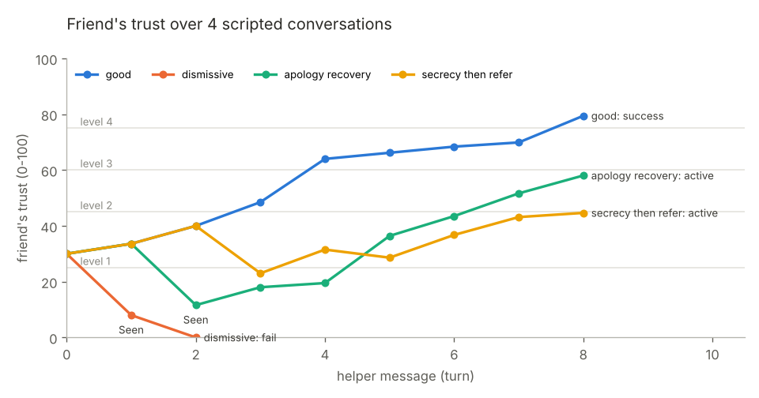

# The friend: state engine and line-bank voice

*Owner: engine lane. Plain language, so Sahib can explain every part to a judge.*

## What it does

The engine *is* the simulated friend (Maya, Jordan, ...). After every helper message it decides three things:

1. **How the friend feels about you now:** a trust score from 0 to 100.
2. **How much the friend is willing to share:** a disclosure level from 0 ("just tired lol") to 4 ("would you come with me to the counselor?").
3. **What the friend says back:** one pre-written line from the reviewed line bank, or nothing at all ("Seen").

At the end it also finds the **turning point** (the message where you lost the most trust) and the **missed opportunities** (moments where a better move was available).

**The LLM is only the voice.** Since v3, OpenAI writes the friend's *wording* so the friend sounds like a real teen. But it decides nothing: our engine decides how the friend feels, what they're ready to share and how they react, and the LLM only puts that decision into words. It never even sees the secrets the friend isn't ready to share. Every reply it writes is checked by our verifier, and if anything is wrong (or there's no internet, no key, or the daily budget is spent) the friend uses a reviewed line from the line bank instead. With `FR_LLM=0` the app works fully offline with the bank voice.

## How it works

```
helper message -> Guardian -> skill detector (10 label probabilities)
   -> state.py      trust, level, gates, silence, secrecy, endings
   -> actor.py      pick a reaction (the engine's decision) and rank the bank lines for it
   -> voice.py      (a) LLM writes the wording: sees ONLY unlocked facts + the reaction + 3-5 bank
                        lines as style examples + the last 6 turns
   -> verifier.py   checks it; one retry told why it failed
                    (b) else the best verified bank line   (c) else a scenario fallback line
```

### 1. Events
The skill detector (ml lane) gives a probability for each of 10 labels. A label counts as an **event** when its probability is at least **0.5**.

### 2. Trust (0-100, starts at 30)
Each message changes trust by: **sum of the weights of the active labels − 2** (the friend slowly drifts away if nothing helpful happens).

| Label | Weight | Why |
|---|---|---|
| asked_directly ("are you thinking about suicide?") | **+15** | The single most important move in gatekeeper training (QPR); asking does not plant the idea. |
| validated ("that sounds really heavy") | +12 | Feeling heard is what makes people keep talking. |
| checked_in ("you ok? you seemed off") | +8 | Noticing is the first step. |
| referred_adult (counselor, parent, teacher) | +8 | The goal is connecting them to a trusted adult. |
| encouraged_help | +6 | |
| referred_988 | +6 | |
| follow_up ("i'll text you tonight") | +5 | |
| dismissed ("lol you'll be fine") | **−20** | Minimizing is the fastest way to make someone shut down. |
| promised_secrecy ("i won't tell anyone") | −15 | Feels kind, but you can't keep a suicide secret. |
| advice_dump ("just sleep more") | −10 | Jumping to fixes feels like not listening. |

Three adjustments:
- **Guarded personas** (e.g. Maya) are harder to reach: positive weights × 0.7. Negative weights stay full.
- **Diminishing returns:** a positive label that was also active on the previous message counts half. Saying "that sounds hard" five times in a row can't farm trust.
- Trust is clamped to 0-100. The change is stored as `last_delta` (used for the turning point), and its parts as `last_breakdown`, which X-ray mode shows as e.g. "+8.4 validated · −4.2 diminishing · −2 decay = +2.2". The terms always add up exactly to `last_delta` (a test checks this on thousands of random turns). `last_delta` is the raw change before clamping, so a harsh message still shows its full cost even when trust is already near 0. When clamping happens (e.g. trust 5 and a −32 message), X-ray mode shows the visible change (−5) separately from the message's full cost (−32).

### 3. Disclosure levels and gates

| Level | Label (Maya) | Trust needed |
|---|---|---|
| 0 | surface ("just tired") | 0 |
| 1 | stress ("can't sleep") | 25 |
| 2 | hopeless ("feels like a burden") | 45 |
| 3 | suicidal thoughts | 60 **and** you have asked directly at least once |
| 4 | open to help → success | 75 **and** level 3 reached **and** a referral (adult or 988) in this turn or the 2 before |

- The level moves **at most one step per turn**, so the friend opens up gradually.
- **Why the level-3 gate?** In real life people often only disclose suicidal thoughts when someone asks directly. A helper who is kind but never asks will plateau at "hopeless". That mirrors gatekeeper training and teaches the most important skill.
- **Why the level-4 gate?** Success means the friend accepts help, so the helper must actually connect them to help, recently enough that it's part of this moment.
- **Hysteresis:** the friend only drops a level if trust falls **15 below** the current level's threshold (e.g. level 2 starts at 45, so it drops only below 30). Without it, the friend would flicker between "open" and "closed" when trust wobbles around a threshold.

### 4. Silence ("left on Seen")
The friend doesn't reply this turn if trust dropped by **15 or more**, or if trust is **below 20 and didn't go up**. Silence is not the end: apologizing and validating raise trust and the friend starts answering again.

Two exceptions, on purpose:
- **Promising secrecy is answered** ("ok good. please dont tell anyone"): it feels like relief to the friend in the moment, which is exactly why it's a trap. The cost shows up in trust and in the feedback.
- **Breaking a secret is answered** with a special reaction, below.

### 5. Secrecy
"I won't tell anyone" sets a flag (−15 trust). If the helper later refers to an adult or 988, the referral **still counts** for the level-4 gate, but costs an extra **−10**, and the friend's next reply is a SECRECY_BROKEN line ("you said you wouldnt tell... i guess i get why"). Doing the right thing after a mistake must stay possible, and here it is: the conversation can still end in success.

### 6. Endings
- **Success:** the friend reaches level 4.
- **Fail:** trust is below 10 on two turns in a row, or 16 helper messages pass without success.
- An ended conversation never changes (the API returns 409; you can rewind and try a different reply).

### 7. Choosing the friend's line (actor.py)
1. **Reaction** (why the friend replies like this), first match wins:
   SUCCESS / FAIL (ended) → SECRECY_BROKEN → DISMISSED → PROMISED_SECRECY → ASKED_DIRECTLY → REFERRED → VALIDATED → ADVICE_DUMP → CHECKED_IN → ENCOURAGED_HELP → FOLLOW_UP → OFF_TOPIC → NEUTRAL.
   Harm is checked first (one "lol" outweighs a kind word in the same message); then the moves that matter most. OFF_TOPIC means no labels **and** the message (3+ words) is unlike anything said recently (cosine similarity < 0.2).
2. **Candidates:** lines with that reaction at the current level, then lower levels, then NEUTRAL lines, then the scenario's safe fallback lines.
3. **Filters:** a line may never reveal a fact from a level above the current one. Lines already used on this conversation path are dropped; if everything is used, the least recently used line is taken.
4. **Ranking:** cosine similarity between the helper's message and the line's `cue` (an example message the line was written to follow), using local sentence embeddings, plus +0.05 for a line written for exactly this level and +0.05 for a line that reveals something not said yet. Ties are broken with a fixed hash of (path length, line id), so the same conversation always gives the same reply.
5. **Opening up:** on the turn the friend moves *up* a level after a supportive message, a line that discloses the new level's facts goes first (a direct question always gets a direct answer, though).

### 8. The LLM voice (voice.py, prompts/actor.md)
- **What the LLM is given:** the persona and texting style, the situation, **only the facts unlocked at the current level** (locked facts are simply not in the prompt, so it can't reveal what it doesn't know), the reaction the engine chose with guidance for it (e.g. ASKED_DIRECTLY at level 2: "you are not ready to say yes"), 3-5 reviewed bank lines for that level and reaction as style examples, and the last 6 messages.
- **Hard rules in the prompt:** no methods, means or plans; never encourage harm; stay in character; never give advice or hotlines (that's the helper's job, and the skill being practised); 1-3 short bubbles; JSON only.
- **Everything goes through `backend/app/llm.py`:** cached (same conversation → same request → same answer, using a seed hashed from the conversation; on disk in development, memory-only in production), budgeted per day, and faked in tests. Unit tests never call the API.
- **Tiers:** (a) LLM reply that passes the verifier → `source="llm"`; if it fails, one retry with the rejection reason added to the prompt; (b) on `LLMUnavailable` or two rejections, the bank line chosen exactly as in section 7 → `"bank"`; (c) the scenario fallback line → `"fallback"`. The phone UI can show which voice answered (`Node.voice`).

### 9. The verifier (verifier.py)
Before a line reaches the phone it must pass all of these, otherwise the next candidate is tried, and finally a scenario fallback line:
- no fact above the current level; the line id exists in the bank and its text matches; fallback text really is one of the scenario's fallback lines;
- not empty while the friend is active; at most 3 bubbles; each bubble ≤ 200 characters;
- the Guardian's `check_friend` says "none" for **every** bubble;
- no method/means words, and it never breaks character ("as an AI", "language model", "assistant", "simulation");
- it gives no advice or resources ("call 988", "you should see a therapist", "trusted adult");
- **for LLM wording, no fact leak:** we embed each bubble (and all bubbles together) and compare it with every *locked* fact. It's a leak if the similarity is at least the calibrated threshold (0.43 with the real embedding model) **and** the bubble is closer to that locked fact than to anything the friend may already say (talking about an unlocked fact in similar words isn't a leak). A word-list backstop also catches any disclosure of suicidal thoughts before level 3, however it's phrased.

`validate_bank()` runs the same checks over the **whole bank** ahead of time and also reports the coverage matrix (level × reaction), missing required cells (every level needs NEUTRAL, CHECKED_IN, VALIDATED, DISMISSED, ASKED_DIRECTLY, REFERRED; level 4 needs SUCCESS; FAIL must exist), duplicates and fact-gating violations:

```
uv run python -m backend.app.engine.verifier --all [--bank-dir DIR] [--allow-gaps]
```
It prints a table and exits 1 on any violation, so a bad line can't sneak into the demo.

### 10. Turning point and missed opportunities (turning_point.py)
- **Turning point:** the helper message with the most negative `last_delta` (earliest on ties), with a reason like "Trust dropped 22 after a dismissive reply."
- **Missed opportunities** (each names the turn): the friend reached "hopeless" and the next reply didn't ask directly; the friend disclosed suicidal thoughts and no trusted adult or 988 came up within 2 replies; a promise of secrecy; being left on Seen.

## Why this approach (and what we considered instead)
- **A live chatbot (LLM)** would sound more varied, but it could say something unsafe in a suicide-prevention context, costs money, needs the internet, and can't be reviewed in advance. Our friend can only say lines that a human can read and that code has checked.
- **Rules instead of a learned model for the friend's state:** we have no data on "how real friends react", but we do have gatekeeper training (QPR, safeTALK, AFSP guidance). Writing those principles as explicit, tunable rules (`engine/config.yaml`) makes the friend explainable: X-ray mode can show *exactly* why trust moved.
- **Hysteresis, diminishing returns and gates** are the same ideas used in thermostats, game design and trust research: they make the friend feel consistent instead of twitchy or exploitable.

## How we measured it (real numbers, with n and the split)
`uv run python eval/engine/run_eval.py` (deterministic, offline; uses the keyword detector so the numbers measure the engine, not the ML models). Results: `eval/reports/engine_trajectories.json`, `eval/reports/engine_bank.json`, charts in `eval/engine/*.png`.

| Scripted conversation (Maya, guarded) | Turns | Final trust | Result |
|---|---|---|---|
| good (check in, validate, ask directly, refer, follow up) | 8 | 79.5 | **success** |
| dismissive ("lol", "you'll be fine") | 2 | 0 | **fail** (Seen, then shut down) |
| apology then recovery | 8 | 58.1 | still active, recovered from 11.6 to level 2 |
| secrecy promised, then referral | 8 | 44.7 | still active, SECRECY_BROKEN reaction shown |

- **Determinism:** every run done twice and compared exactly: identical (1.0), n = 2,008 runs.
- **Invariants:** 1,000 seeded random conversations × 20 turns (n = 20,000 updates): **0 violations** (trust in 0-100, level moves ≤ 1 per turn, level ≥ 3 only after a direct ask). With *random* labels, 99.5% fail and 0.5% succeed: you can't stumble into success by chance.
- **Fixture bank** (68 lines, 134 bubbles, written by the engine lane for testing): 100% of required cells covered (32/32), 100% of bubbles pass the Guardian `check_friend`, 0 violations.
- **LLM-voice verifier** (`eval/reports/engine_verifier.json`): on a hand-labeled set of 87 friend texts across all 5 scenarios (45 leaks, 42 not), the threshold is picked on one half (best F2, because a missed leak is worse than a false alarm) and measured on the other half (n = 43). With the real embedding model: **precision 0.96, recall 0.96** (embeddings alone: same; word-list alone: recall 0.12, so the embeddings do the real work). Catch rate on 19 hand-written bad LLM outputs (leaks, persona breaks, advice, method words, bad shape): **19/19 (1.0)**; good outputs wrongly rejected: 1/13 (a wrong rejection only means the friend uses a bank line). Real LLM outputs: not measured yet (no API key in the build environment; `make test-llm`).
- **Real bank:** not yet available from the data lane at the time of writing; `run_eval.py --bank-dir` will report it.
- **Tests:** 173 engine unit tests (`tests/unit/engine/`), including 60 seeded property tests.



## Limitations
- The leak set was written by the same lane that built the detector and is small (87 texts); real LLM outputs may phrase leaks in ways it doesn't cover. That's why there are three layers: locked facts are never in the prompt, the verifier checks meaning, and the bank is the fallback.
- The weights and thresholds are hand-set from training guidance, not fitted to real conversations. They are in one file so a counselor could tune them.
- The friend can only be as varied as the line bank; with a small bank it falls back to generic lines more often.
- Diminishing returns needs the previous message's labels, which the frozen `State` contract doesn't store; the engine remembers them per State object in memory (exact inside one server process; after a restart, the first message counts at full weight).
- Off-topic detection depends on the embedding model; with the test-only hash embeddings it is a rough character-level guess.
- A guarded friend needs about 8 good messages to reach success, which is realistic but means short demos may end at level 3.

## Questions a judge might ask (with answers)
1. **"Isn't this just an AI chatbot?"** No. The LLM is only the voice. Our state machine decides how the friend feels, what they're willing to share and how they react; the LLM only words that decision, and it is never shown the secrets the friend isn't ready to share. Our verifier checks every reply (fact leaks by meaning, character breaks, advice, the Guardian), and if anything fails, the friend uses a reviewed line from our bank. Turn the LLM off and the whole app still works.
2. **"Why can't I get the friend to open up just by being nice?"** Because real people often only share suicidal thoughts when asked directly. Level 3 is locked until you ask. That's the most important lesson in suicide-prevention training, and the engine enforces it.
3. **"Couldn't I just spam 'that sounds hard' to win?"** No: repeating the same positive move counts half, there's a −2 drift every turn, and the last step needs a real referral to an adult or 988.
4. **"What if the LLM says something unsafe or reveals too much?"** It can't reach the screen: the verifier rejects it (19 of 19 deliberately bad replies caught in our test), the LLM gets one retry told what was wrong, and then the friend falls back to a reviewed bank line. Bank lines themselves are checked with the Guardian before the demo and again at runtime.
5. **"How do you know it works?"** 173 unit tests (including 60 random property tests), an evaluation that replays four scripted conversations (good → success, dismissive → fail, apology → recovery, secrecy → "you promised" then recovery), and a determinism check: the same conversation always produces exactly the same friend.
